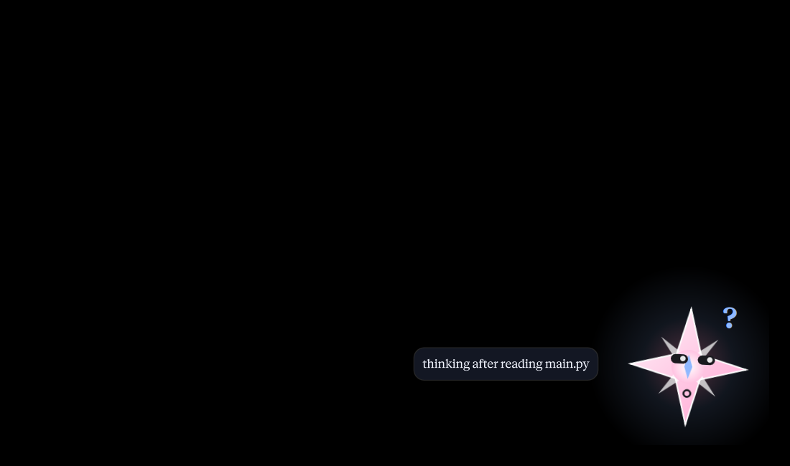
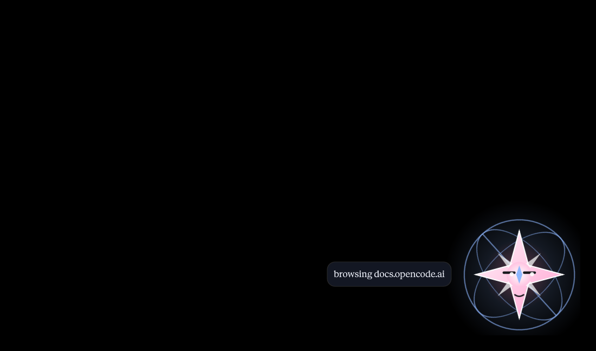
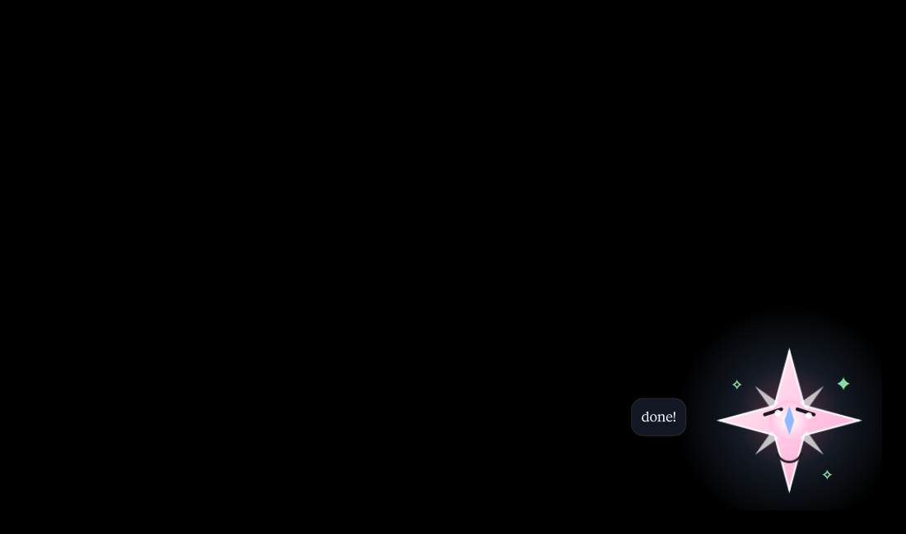
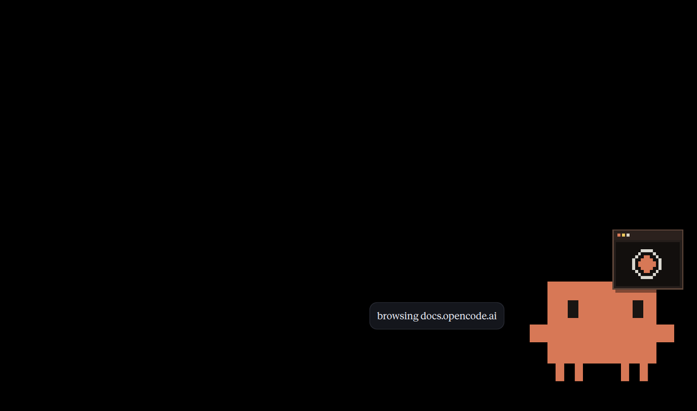
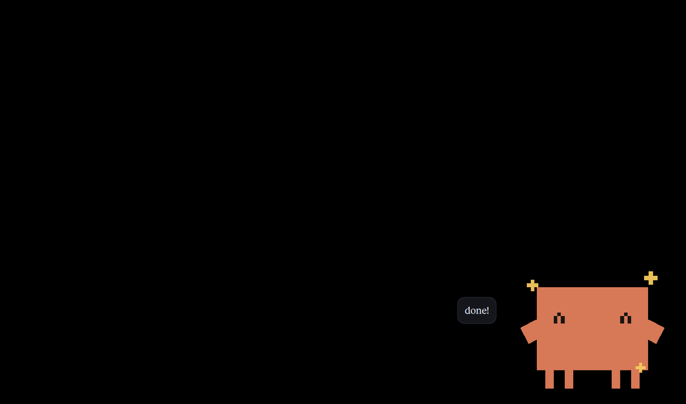

# Mascot Code

[](https://github.com/zcyrl/mascot-code/releases)
[](LICENSE)

A small desktop mascot for [OpenCode](https://opencode.ai). **Empo** is the glowing compass-star; **Claude** is the blocky orange crab from Claude Code. Both read the same state file and share the same nine expressions.

I use OpenCode a lot, and I wanted something that shows what the agent is actually doing without me staring at the terminal the whole time. The Claude Code mascot was the inspiration, but I'm on Linux, so this is a Quickshell layer-shell overlay instead of an Electron app. No npm, no browser, no GTK window pretending to be a pet.

Empo is a glowing compass-star. He reads files, types, runs commands, browses docs, gets happy when a session finishes, droops when something fails, and falls asleep after a minute of quiet. On my niri + [iNiR](https://github.com/snowarch/iNiR) setup he also steps out of the way while the OpenCode terminal is focused, then comes back when I look somewhere else.



## Two characters

**Empo** is the original: a glowing compass-star with a keyboard, a book and a globe. **Claude** is Anthropic's pixel crab, redrawn in QML with the same nine poses. Same state file, same plugin, same overlay; only the drawing changes.


Switch at runtime:

```bash
inir ipc mascotcode character claude
inir ipc mascotcode character empo
```

Or set `character` in `~/.config/mascot-code/config.json`. The shared picker file
`~/.config/mascot-code/character.json` wins over both. The standalone build uses
`MASCOT_CHARACTER=claude` (or `empo`) when you start it.

## Pick with `/mascot`

In the OpenCode TUI, type `/mascot`. In OpenCode Desktop, type it in the composer or pick **Choose mascot** from the command palette. A floating card shows Empo and Claude; hover a card to watch it cycle through its nine expressions, then click it to choose.

The picker is one plugin with three parts:

- a server part that keeps writing OpenCode's state
- a TUI card for the terminal
- a desktop card for OpenCode Desktop 2.2 or newer

Whichever picker you use writes `~/.config/mascot-code/character.json`. The iNiR and standalone overlays read that file first, so the desktop mascot switches immediately. The saved choice also survives an OpenCode restart.

## What they actually do

| OpenCode is doing | Mascot |
| --- | --- |
| `read`, `glob`, `grep`, `list` | eyes scan a page, bubble says `reading main.py` |
| `edit`, `write`, `patch` | typing on a tiny keyboard, bubble says `coding test.py` |
| `bash` / shell | scuttling with speed lines, bubble says `running pytest -q` |
| `webfetch`, `websearch` | a globe or browser card appears, bubble says `browsing docs.opencode.ai` |
| thinking between tools | looks up with a `?`, bubble says `thinking after reading main.py` |
| session idle | jumps with sparkles, `done!` |
| session failed | droops, a tear, `error: ...` |
| 60s without an event | sleeps, closed eyes, `zZ` |

Tools are often faster than the eye. The mascot holds an action for about 1.2 seconds before settling into the thinking pose, so you actually see the read or edit happen.

## Screenshots

### Empo

| Coding | Browsing |
| --- | --- |
|  |  |

| Happy | Sleeping |
| --- | --- |
|  |  |

### Claude

| Coding | Browsing |
| --- | --- |
|  |  |

| Happy | Sleeping |
| --- | --- |
|  |  |

## How it works

There are three pieces:

1. **The OpenCode plugin** writes the current state to `/tmp/opencode-mascot.json`.
2. **The Quickshell overlay** watches that file and draws the selected mascot.
3. **The character layer** maps the state to an expression. Empo was the first character; Claude is the second, and the switchboard is built for more.

The state file looks like this:

```json
{
  "state": "reading",
  "detail": "main.py",
  "ts": 1793869420662,
  "sessionID": "ses_e584..."
}
```

The plugin writes atomically (temp file + rename), so the overlay never reads half a JSON document. In the iNiR build a long-lived `inotifywait` watches `/tmp` for the rename. The standalone build simply re-reads the file once a second because it has to work everywhere.

The plugin also tracks **per-session** state and follows the session selected in the TUI. A subagent or a background session cannot hijack the bubble. When the mascot says `thinking after reading main.py`, that is the session you are actually looking at.

## What you need

- OpenCode 2.x. The V2 plugin API is what this uses; tested on `2.2.5`.
- OpenCode Desktop 2.2 or newer for the desktop `/mascot` card. The 2.1.x desktop app has no GUI plugin API yet; the TUI picker works there regardless.
- Quickshell 0.3 or newer. Tested on `0.3.2`.
- A Wayland compositor with layer-shell.
  - **Focus-aware hiding** needs niri + iNiR 3 (or iNiR 2). That version talks to `niri msg`.
  - **Everything else** works in the standalone build on Hyprland, Sway, river, and friends.
- `procps` (`pgrep`, `ps`) and, for the iNiR build, `inotify-tools` (`inotifywait`).
- No npm install. The plugin imports `@opencode/plugin` from the OpenCode runtime.

Arch:

```bash
sudo pacman -S quickshell inotify-tools procps
```

Package names differ on Fedora/Debian/openSUSE; the standalone release only needs Quickshell and `procps`.

## Install

### 1. Clone

```bash
git clone https://github.com/zcyrl/mascot-code.git
cd mascot-code
```

### 2. Install the OpenCode plugin first

Do this before the overlay so you can confirm real events arrive.

```bash
mkdir -p ~/.config/opencode/plugins
cp -a opencode/mascot ~/.config/opencode/plugins/mascot
opencode plugin list
```

You should see `zcyrl.mascot` in the list. Then test the file:

```bash
echo '{"state":"coding","detail":"test.py"}' > /tmp/opencode-mascot.json
watch -n 0.5 cat /tmp/opencode-mascot.json
```

Run OpenCode in another terminal and ask it to read and edit a file. The state should move through `reading`, `coding`, `thinking`, and eventually `sleeping`. If it doesn't, check `opencode plugin list` and the OpenCode log before touching the overlay.

### 3A. Install the iNiR version

Use this if you are on niri with iNiR 3 (or the older iNiR 2). It gives you the
focus-aware hide/show behaviour.

```bash
./install-inir.sh
```

The installer backs up your existing mascot module and config first. It copies:

- `opencode/mascot/` → `~/.config/opencode/plugins/mascot/`
- `inir/modules/mascot/` → `~/.config/quickshell/inir/modules/mascot/`
- `inir/scripts/opencode-mascot-focus.sh` → `~/.config/quickshell/inir/scripts/`
- writes `~/.config/mascot-code/config.json`
- on iNiR 3, registers `mascot` in `~/.config/quickshell/inir/plugins.list`
- on iNiR 2, adds `mascot.codingCompanion` to `~/.config/inir/config.json`

Then:

```bash
inir restart
inir ipc mascotcode status
inir ipc mascotcode character empo
```

iNiR 3 loads Mascot Code as a **component plugin** (`plugin.json`), so it lives
beside iNiR's own mascot instead of replacing it. Its IPC target is
`mascotcode`; iNiR's own companion keeps `mascot`. On iNiR 2, add the snippet
from [`inir/config/Config-schema.qml`](inir/config/Config-schema.qml) to the
`mascot` object in `Config.qml` if the installer says the key is missing.

On niri + iNiR, the behaviour is:

- OpenCode is open (TUI or Desktop), its window **not** focused → the mascot appears.
- OpenCode window **focused** → the mascot slides away.
- OpenCode closes → the mascot disappears, even if a background server or a
  multiplexer pane survives the window.
- DND, fullscreen, lock screen, session screen, region selector, recording → the mascot stays hidden.

### 3B. Install the standalone version

Use this on any other distro or compositor. It does not need iNiR or niri. It shows while `opencode` is running and does not hide when the terminal is focused.

```bash
./install-standalone.sh
systemctl --user daemon-reload
systemctl --user enable --now mascot-code.service
```

Or just run it for the session:

```bash
qs -p ~/.config/quickshell/mascot-code
```

The standalone release is also attached to the GitHub release as a tarball.

## Test every state

```bash
echo '{"state":"idle","detail":""}'                     > /tmp/opencode-mascot.json
echo '{"state":"thinking","detail":"planning"}'         > /tmp/opencode-mascot.json
echo '{"state":"reading","detail":"main.py"}'           > /tmp/opencode-mascot.json
echo '{"state":"coding","detail":"test.py"}'            > /tmp/opencode-mascot.json
echo '{"state":"running","detail":"pytest -q"}'         > /tmp/opencode-mascot.json
echo '{"state":"browsing","detail":"docs.opencode.ai"}' > /tmp/opencode-mascot.json
echo '{"state":"happy","detail":"done!"}'               > /tmp/opencode-mascot.json
echo '{"state":"sad","detail":"tool failed"}'           > /tmp/opencode-mascot.json
echo '{"state":"sleeping","detail":""}'                 > /tmp/opencode-mascot.json
```

If you omit `ts`, the mascot treats it as "just now" and the 60-second sleep still works. The state file is character-agnostic: these commands work for Empo and Claude alike.

## Adding characters and animations

Empo and Claude are not hardcoded into the companion. `CharacterHost.qml` is the switchboard, and `characters/` is where characters live.

A character is a QML component with this contract:

```qml
Item {
    property string expression   // idle | thinking | reading | coding | running | browsing | happy | sad | sleeping
    property bool active         // stop loops when false
    property bool reducedMotion  // respect Appearance.animationsEnabled
    // optional theme inputs: accent, accentAlt, ink, errorColor, successColor, surfaceColor, fontFamily
}
```

To add one:

1. Drop `characters/YourCharacter.qml` into `inir/modules/mascot/characters/`.
2. Add `YourCharacter 1.0 YourCharacter.qml` to that directory's `qmldir`.
3. Add a `Component` and a `case` in `CharacterHost.qml`.
4. Set `character` in `~/.config/mascot-code/config.json` to `"yourcharacter"`
   or use
   ```bash
   inir ipc mascotcode character yourcharacter
   ```

Empo himself is `inir/modules/mascot/characters/Empo.qml`. The file is 800 lines of pure QML: a static Canvas for the star and glow, QML items for the face, and transform/opacity animations for the rest. Claude is drawn by `characters/Claude.qml`: a 300x300 pixel-art stage of plain rectangles, scaled to the sprite size, so the blocks stay crisp. You can copy either one as a starting point. See [`inir/modules/mascot/characters/README.md`](inir/modules/mascot/characters/README.md) for the details.

## Troubleshooting

**Nothing appears.** Check the plugin state file first:

```bash
cat /tmp/opencode-mascot.json
opencode plugin list
```

**iNiR build says the module is unavailable.** Read the QML log:

```bash
inir logs --issues
inir logs -n 200
```

**The mascot appears but doesn't update.** Make sure `inotifywait` exists:

```bash
command -v inotifywait || sudo pacman -S inotify-tools
```

**Focus hide/show doesn't work.** Check that niri can see the terminal:

```bash
niri msg windows
~/.config/quickshell/inir/scripts/opencode-mascot-focus.sh \
  "$(niri msg focused-window | sed -n 's/^  PID: //p')"
```

Expected: `focused`, `unfocused`, or `none`.

**Two mascots.** You are running the standalone and iNiR builds at once. Stop one:

```bash
systemctl --user stop mascot-code.service
```

## License

GPL-3.0-only. That is the "same project, keep my name on it" license — strong copyleft. If you fork it, modify it, or ship it, the derivative stays under GPL-3.0 and keeps the notices.

`MascotCompanion.qml` is derived from iNiR's mascot companion, which is also GPL-3.0. The upstream project is [snowarch/iNiR](https://github.com/snowarch/iNiR). Empo, Claude's QML interpretation, the OpenCode plugin, the standalone overlay and the installer scripts are original work by [Softbrick (zcyrl)](https://github.com/zcyrl), released under the same license.

Claude is Anthropic's character for Claude Code. This project is an unofficial fan interpretation, not affiliated with or endorsed by Anthropic. The code is GPL-3.0; the character and trademark remain Anthropic's.

See [`LICENSE`](LICENSE) and [`NOTICE`](NOTICE).

## Credits

- **Softbrick (zcyrl)** — Empo, Claude's QML, plugin, overlay, glue and the late-night debugging.
- **Anthropic** — Claude and the Claude Code mascot this homage is based on.
- **iNiR / snowarch** — the mascot companion foundation, settings conventions and the GPL-3.0 base.
- **OpenCode** — the agent and its plugin API.
- **Quickshell** — the thing that makes a transparent Wayland overlay this easy.
